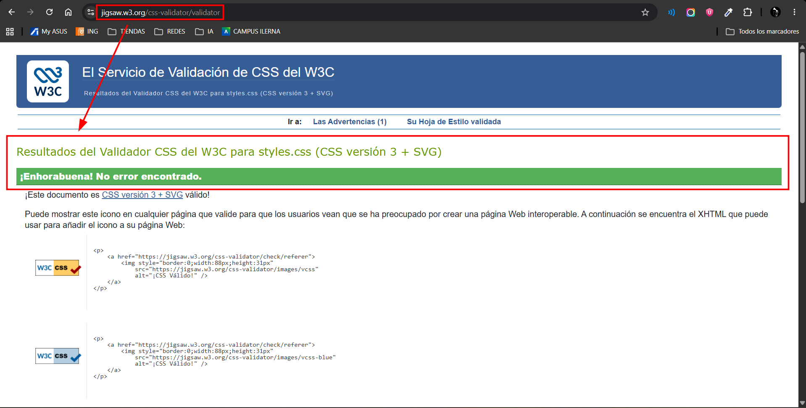

# Landing Page - Sevilla FC (Versión SCSS)

Proyecto de desarrollo de una **Landing Page** responsiva dedicada al **Sevilla Fútbol Club**. Para esta versión del proyecto, se ha reconstruido y estructurado toda la landing page desde el principio utilizando el preprocesador **SASS / SCSS**, manteniendo con total fidelidad el diseño visual, la identidad corporativa y la experiencia de usuario de la versión original.

La web ofrece un recorrido visual e interactivo por la identidad, historia, títulos, estadio, plantilla y patrocinadores del club nervionense, estructurada en una sola página (*Single Page Application*) con navegación fluida, diseño adaptable a cualquier dispositivo y soporte completo para modo claro y oscuro.

---

## Migración y Arquitectura con SCSS

La principal novedad de esta rama radica en la reimplementación integral de las hojas de estilo mediante **SCSS**, aprovechando las ventajas de la preprocesamiento CSS moderno:

* **Estructura modular y limpia**: Separación lógica entre los estilos base del sitio ([`scss/styles.scss`](scss/styles.scss)) y los estilos específicos del tema oscuro ([`scss/dark.scss`](scss/dark.scss)), que compilan respectivamente a [`css/styles.css`](css/styles.css) y [`css/dark.css`](css/dark.css).
* **Variables SASS**: Centralización de tokens de diseño como colores corporativos (`$color-primary: #D10000`, `$color-white`, etc.), tipografías (`$font-main`), paleta del modo oscuro (`$bg-dark`, `$text-light`, `$card-bg-dark`, `$red-accent`) y bordes, facilitando el mantenimiento y la escalabilidad.
* **Funciones y Módulos Modernos**: Empleo de las directivas `@use "sass:math"` y `@use "sass:color"`, incorporando funciones como `px-to-rem($pixels)` para cálculos tipográficos y espaciados dinámicos.
* **Mixins Responsivos**: Definición de mixins de breakpoints (`@mixin respond-to($breakpoint)`) para encapsular media queries de tablet y escritorio (`respond-to('tablet')`, `respond-to('desktop')`), garantizando un código conciso y ordenado.
* **Anidamiento (*Nesting*) y Selector Padre (`&`)**: Organización jerárquica de selectores, estados interactivos (`:hover`, `:focus`) y elementos anidados en tarjetas, navegación y componentes sin redundancia en el código fuente.
* **Mismo diseño visual**: A pesar de reconstruir los estilos desde cero con SCSS, se preservan al 100% las proporciones, paletas, efectos hover, transiciones y adaptabilidad responsive originales.

---

## Archivos Principales del Proyecto

* **[index.html](index.html)**: Código fuente principal de la aplicación web. Desarrollado con **HTML5 semántico**, **Bootstrap 5.3**, estilos generados mediante SCSS y JavaScript para la interactividad del cambio de tema y menú móvil.
* **[scss/](scss/)**: Directorio con los archivos fuente en SCSS:
  * **[scss/styles.scss](scss/styles.scss)**: Hoja principal con variables, funciones, mixins, tipografía, navegación, secciones, rejilla de jugadores y footer.
  * **[scss/dark.scss](scss/dark.scss)**: Variables y reglas específicas para la adaptación al modo oscuro.
* **[css/](css/)**: Archivos CSS compilados a partir de los SCSS:
  * **[css/styles.css](css/styles.css)**: Estilos base compilados.
  * **[css/dark.css](css/dark.css)**: Estilos del modo oscuro compilados.
* **[MOCKUP.jpg](MOCKUP.jpg)**: Imagen de diseño conceptual y esquema de referencia inicial que define la estructura y composición visual de la web.

---

## Estructura y Secciones (Navbar)

La navegación principal se compone de **5 secciones clave** accesibles desde la barra de navegación superior (*Navbar*), la cual incorpora menú hamburguesa colapsable en dispositivos móviles y un selector interactivo de **Modo Oscuro / Modo Claro**:

1. **Historia (`#historia`)**
   * Orígenes del club desde su fundación el 25 de enero de 1890 y la figura de su primer presidente, Edward Farquharson Johnston.
   * Tres tarjetas de datos destacados: más de 80 temporadas en Primera División, el Himno del Centenario (2005) y la designación de Mejor Club del Mundo (2006 y 2007).

2. **Títulos (`#titulos`)**
   * Vitrina de trofeos oficiales nacionales e internacionales con los años de conquista:
     * **7 UEFA Europa League** (2006, 2007, 2014, 2015, 2016, 2020, 2023).
     * **1 Supercopa de Europa** (2006).
     * **1 Liga Española** (1946).
     * **5 Copas del Rey** (1935, 1939, 1948, 2007, 2010).
     * **1 Supercopa de España** (2007).

3. **Estadio (`#estadio`)**
   * Imagen panorámica del **Estadio Ramón Sánchez-Pizjuán** ("La Bombonera de Nervión") y reseña histórica sobre el emblemático mosaico de Preferencia creado para el Mundial de 1982.
   * Tres tarjetas con la información técnica esencial del recinto:
     * **Nombre Oficial**: Ramón Sánchez-Pizjuán.
     * **Inauguración**: 7 de septiembre de 1958.
     * **Aforo**: 43.883 espectadores.

4. **Plantilla (`#plantilla`)**
   * Presentación del primer equipo masculino organizado por posiciones: **Porteros**, **Defensas**, **Mediocentros** y **Delanteros**.
   * Tarjetas fotográficas con el **nombre** y el **número de dorsal** de cada jugador, con tipografía fluida adaptativa que evita solapamientos tanto en vista de escritorio como en móvil.

5. **Patrocinios (`#patrocinio`)**
   * Presidencia del patrocinador técnico principal (**Adidas**) y galería con los 10 patrocinadores y socios comerciales oficiales (*Socios.com, CaixaBank, Cruzcampo, MatchWornShirt, Viagogo, Say TV, Scalpers, Coca-Cola, Robles y Andalucía*).
   * Todos los logotipos cuentan con enlaces directos a sus sitios web y efectos de hover sutiles.
   * **Distribución responsiva**: Los patrocinadores se muestran en una sola fila centrada en escritorio y organizados en una cuadrícula de dos en dos (2 columnas) en dispositivos móviles sin barras de desplazamiento.
   * Lema icónico sevillista: **"NUNCA TE RINDAS"** en tipografía corporativa.
   * Pie de página final con enlaces a las redes sociales oficiales del club (*X/Twitter, Instagram, Facebook, YouTube y TikTok*) y aviso legal de derechos reservados.

---

## Características Técnicas y Diseño

* **Preprocesador SASS / SCSS**: Código modular, anidamiento jerárquico, variables, mixins responsivos y funciones reutilizables.
* **Diseño Responsivo**: Rejilla fluida y puntos de ruptura adaptados a cualquier resolución de pantalla (móvil, tablet y escritorio).
* **Tipografía Corporativa**: Integración de la fuente tipográfica corporativa `MontecatiniPro`.
* **Modo Oscuro / Claro**: Conmutador dinámico que alterna entre las hojas de estilo (`styles.css` y `dark.css`), iconos y mosaicos de fondo.

---

## Validación W3C

La hoja de estilos (`css/styles.css`) ha sido validada satisfactoriamente mediante el servicio oficial **W3C CSS Validator** (CSS versión 3 + SVG), certificando que cumple con los estándares web y no contiene errores:

---

## Enlace web - SASS

Enlace web: [https://LastraMigue.github.io/LandingResponsiva_SASS](https://LastraMigue.github.io/LandingResponsiva_SASS)
